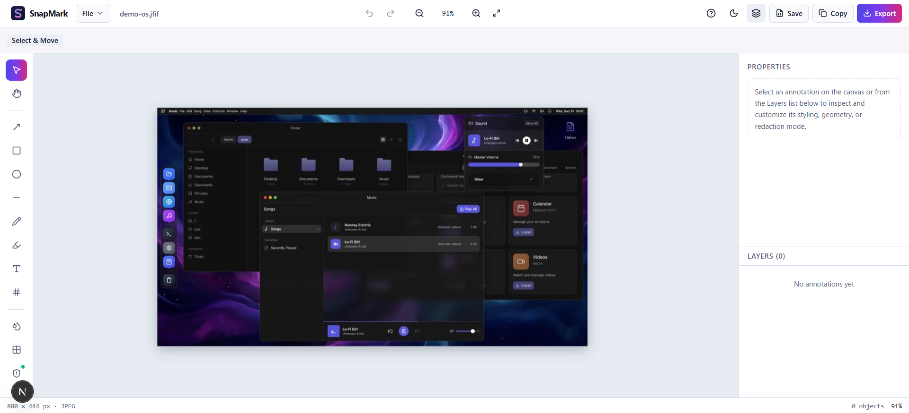

# SnapMark Studio

**SnapMark Studio** is a privacy-first, browser-based screenshot annotation and redaction app for anyone who needs to mark up a screenshot. Add arrows, highlights, numbered steps, and text, hide private details for good, and save the result as a PNG or JPEG. Everything runs on your device: no uploads, no sign-up.

**[Try it live → snapmark-studio.pages.dev](https://snapmark-studio.pages.dev/)**



---

## Features

- **Markup tools:** arrows, rectangles, ellipses, lines, a freehand pen, a highlighter, text notes, and auto-numbered step badges.
- **Hide private info:** blur, pixelate, or cover areas with a solid block that is permanently removed from the saved image.
- **Easy import:** paste with `Ctrl/Cmd + V`, drag and drop, or choose a file.
- **Export:** download a PNG or JPEG at 0.5x to 3x size, or copy straight to your clipboard.
- **Save your work:** save a project file and reopen it later to keep editing.
- **Undo and redo**, keyboard shortcuts, and light and dark themes.

## Privacy

- Your images never leave your browser. Nothing is uploaded, and there are no accounts or tracking.
- Recovery drafts are **off by default**. If you turn them on, they are kept only in your own browser and can be cleared with one click.

## Hiding Sensitive Information

SnapMark has three ways to cover things up, and they are **not** equally safe:

| Tool | Shortcut | Safe for passwords, keys, personal data? |
| :--- | :---: | :--- |
| **Redact** (solid block) | `K` | **Yes.** The covered pixels are permanently replaced in the exported image and cannot be recovered. |
| **Blur** | `B` | **No.** Good for softening clutter, but blurred text can sometimes be reconstructed. |
| **Pixelate** | `X` | **No.** Same as blur: decorative only. |

The highlighter (`M`) is always see-through, so never use it to hide text. Blur and pixelate areas can be turned into a solid redaction with one click.

## Supported Files

| | |
| :--- | :--- |
| **Open** | PNG, JPEG, and WebP images up to 50 MB (max 12,000 px on a side), or a saved `.snapmark.json` project |
| **Export** | PNG or JPEG (adjustable quality) at 0.5x, 1x, 2x, or 3x size, or copy as PNG |

## Known Limitations

- Very large images can't be exported at 3x size because of browser memory limits. Choose 1x or 2x instead.
- **Copy to clipboard** needs a browser that supports it and a secure (`https`) page. Downloading always works.
- Project files contain the original screenshot, so they are a bit larger than the image itself.

---

## Run It Locally

Requires Node.js 20.9 or newer.

```bash
npm install
npm run dev
```

Then open [http://localhost:3000](http://localhost:3000).

Other commands: `npm test` runs the tests, and `npm run build` creates a production build in `out/`.

Built with Next.js, React, TypeScript, Tailwind CSS, and Konva.
